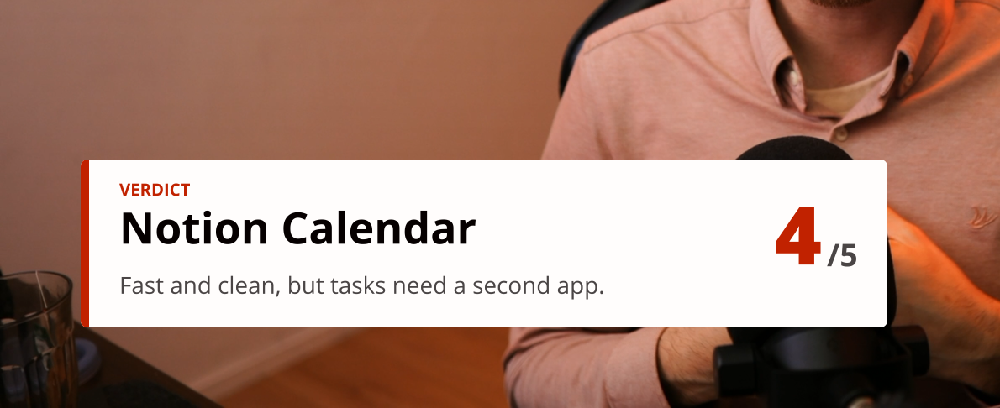
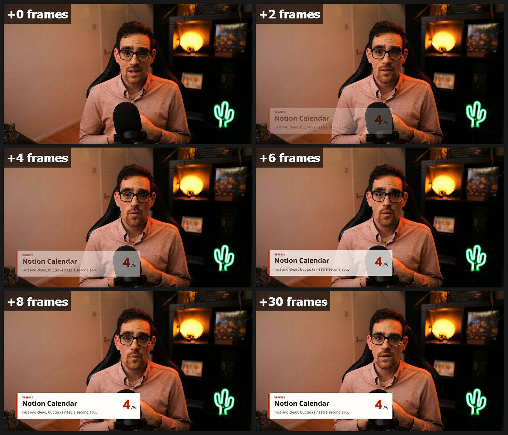

# Resolve as the motion engine

**Verdict: Resolve works as the one engine** for templated motion such as verdict cards, lower thirds and
title cards. A template is a plain text file that AI can write. One command fills it in and puts it on the
timeline, and Lex can still change the text in Resolve's Inspector afterwards. The limits are listed below.
None of them blocks this kind of work.

Tried on 2026-11-18 with DaVinci Resolve Studio 21.2 on Lex's Windows PC. I used a throwaway project,
`ZZ Motion proof - throwaway`. None of Lex's real projects were opened.



The entrance, frame by frame at 30 fps (frames 0, 2, 4, 6, 8 and 30 after the card starts):



## What is in the repo

| File | What it is |
|---|---|
| `motion/templates/verdict-card.setting` | The verdict card: a Fusion title template, as text |
| `tools/motion_place.py` | Puts a template on the open timeline and fills in its text |
| `tools/motion-place.ps1` | The same, as a PowerShell command for Lex |
| `tests/test_motion_place.py` | Checks that the template and the script stay in step (no Resolve needed) |
| `motion/proof/` | The pictures above, exported by Resolve itself |

## Filling in a card (the everyday job)

Resolve has to be open with the edit's project and timeline loaded. Then:

```powershell
.\tools\motion-place.ps1 -Tool "Notion Calendar" -Score 4 -Reason "Fast and clean, but tasks need a second app." -At 01:00:12:00
```

- The card starts at that timeline timecode and stays 5 seconds (`-Seconds 3` for shorter).
- It goes on the top video track if that track is above V1 and free for the whole time. Otherwise it gets a
  new track on top. Clips already on the timeline should never move: the script compares every clip before
  and after, and if anything changed it removes the card again and stops. If other clips are still moved
  after that, it says so; press undo in Resolve to put them back.
- `-Project "VID-7 Black Friday packs"` makes it refuse to touch any other project.
- `-Label "TRIED IT"` changes the small orange word above the tool name (it says VERDICT by default).
- To change the text afterwards, select the card in Resolve and open Inspector > Video. You'll see the
  fields "Tool name", "Score (out of 5)", "Reason (one line)" and "Label".

An AI agent does the same with `python tools/motion_place.py --install --tool ... --score ... --reason ... --at ...`
(`--install` copies the template into Resolve first, as the PowerShell command always does).
It can add `--frames <folder>` to save pictures of the result, so it can check its own work. That is how the
pictures above were made.

## Making a new template (AI writes the text file)

A `.setting` file is the same thing Fusion saves when you copy nodes. AI can write one by hand:

1. Copy `verdict-card.setting` and change what it draws. Each tool (`Background`, `RectangleMask`, `TextPlus`,
   `Merge`) is a block of inputs.
   - Positions run from 0 to 1 across the frame, with (0, 0) at the bottom left.
   - Colours are red, green and blue from 0 to 1. The Techies orange `#C12200` is 0.757, 0.133, 0.
   - Text uses `Font` and `Style`.
2. Mark the fields a person may change as `InstanceInput` lines at the top of the file. Those become the
   Inspector fields.
3. Add the template's name, its fields and its macro name to the three lists at the top of
   `tools/motion_place.py`.
4. Run the script with `--install --frames <folder>` on a throwaway project. Resolve picks up a new or changed
   template right away, without a restart. Then look at the pictures.
5. Run `bash scripts/agents/run-tests.sh`. The tests catch the mistakes I hit while building this one.

Two things to know:

- **Every image tool needs `UseFrameFormatSettings = 1`.** A tool loaded from a `.setting` file that leaves this
  out falls back to 320 × 240 pixels, and the card renders soft and in the wrong place. A test checks for it.
- **A mask's height is measured against the frame height, its width against the frame width.** Text size is
  measured against the frame width. Resolve's own reference describes these differently, so check a picture.

## Limits, honestly

- **Resolve must be running**, with the project open. Nothing renders or places without the app. There is no
  background render server.
- **Studio is needed for scripts from outside Resolve.** The "External scripting" setting (Preferences > System >
  General, set to Local) is a Studio setting. The free version only runs scripts from its own Workspace >
  Scripts menu. Lex has Studio, and the setting is already on.
- **A card is 5 seconds at most when placed by script.** That is Resolve's standard length for titles. Shorter
  works. For longer, drag the card's end in Resolve, or raise the standard length in Resolve's preferences.
- **A card is at least 9 frames**, so it finishes its entrance and is seen fully at least once (0.3 seconds at
  30 fps). A shorter `--seconds` is refused before anything is placed.
- **Resolve's own "insert title" command pushes later clips along the track.** The script gets around this: it
  inserts at the very end of the timeline and then moves the card into place. If Resolve ever changes that
  behaviour, the before-and-after check stops the script.
- **The entrance length is set in frames**: 8 frames, a fade with a short rise and no bounce. That is 267 ms at
  30 fps and 333 ms at 24 fps, so it stays under 400 ms at 24 fps and up. At 60 fps it gets twice as fast.
- **Text doesn't shrink to fit.** The reason fits about 50 characters before it runs under the score, a few
  fewer beside a score like 4.5, and the bigger tool name about half as many. The small label gets the same room
  at its own size and letter spacing: about 45 capitals in a row, or about 50 with spaces between words.
  The script measures the text with the font's own letter widths and refuses text that is too wide before it
  touches Resolve; keep the reason to one short line and shorten a long product name. Text with a line break or
  tab is refused too, as each line has a fixed place on the card.
- **Fonts:** the brand fonts Inter and Roboto Mono are not installed on this PC, so the card uses Open Sans,
  which comes with Resolve. Once Inter is installed, change `Font = "Open Sans"` to `Font = "Inter"` in the
  template.
- **Exit:** the card has no animated exit yet. Add a short fade at its end in Resolve, or ask for an exit in
  the template.
- **Not tried yet:** Resolve 21 can also play Lottie animations and OGraf HTML graphics natively. Those could
  bring web-style motion into the same engine. This proof didn't test them.

## Clean-up

The proof left a throwaway project called `ZZ Motion proof - throwaway` in Resolve's project list. Open it to
look at the cards, or delete it. The template is installed in Resolve's own folder for title templates, as
`Templates\Edit\Titles\Techies\Verdict Card.setting`. The script finds it there by name, and it should also be
in the Effects library under Titles. I haven't looked at the library myself.
